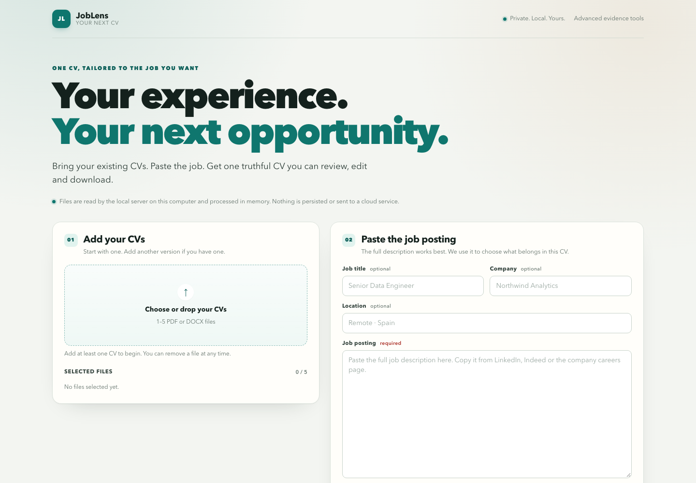
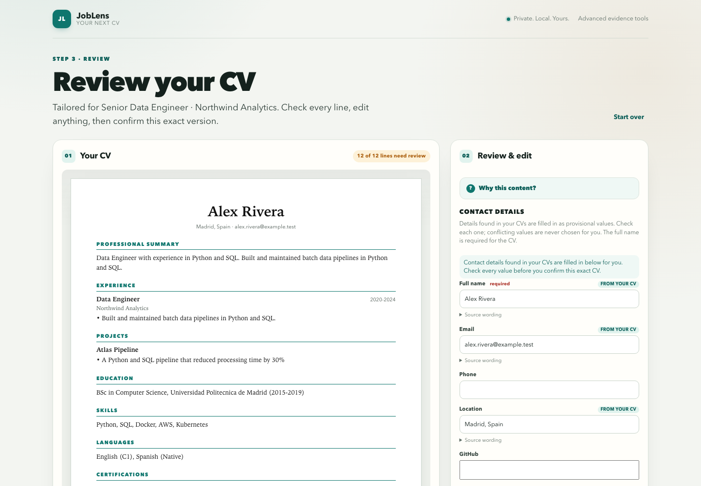
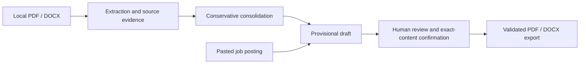

# JobLens

**Turn multiple CVs into one evidence-grounded resume tailored to a job posting.**

[](https://github.com/samugc/JobLens/actions/workflows/ci.yml)

JobLens is a local Python application with an interactive browser interface. Upload
1–5 PDF/DOCX CVs, paste a job posting, review the proposed wording and download a
confirmed PDF or DOCX. No account, cloud model or Ollama installation is required.
This is software you run locally, not a hosted web service.

## Why JobLens?

Different versions of a CV often contain different projects, skills and details.
JobLens consolidates their evidence, omits unresolved contradictions and selects
relevant material for a specific posting. A requirement in the posting never
becomes evidence that the candidate has that skill.

**Upload → analyze source evidence → tailor → review and edit → confirm → export.**

- PDF/DOCX extraction with exact quotations, page/paragraph locators and Unicode offsets.
- Conservative consolidation, with explanations for included and omitted information.
- Deterministic job-specific drafting, without a language model in the web workflow.
- Editable contact details, wording, item inclusion and section order.
- Exact-content confirmation: editing invalidates permission to export.
- Real, single-column A4 PDF and DOCX exports with selectable text and hyperlinks.

The editor is a content preview, not a pixel-identical Word/PDF pagination simulator.





These are current-product captures from the real local backend using the bundled
fictional Alex Rivera documents. Historical `/demo/` images are not used here.
See [screenshot notes and regeneration steps](docs/screenshots/README.md).

## Quick start

Requires **Python 3.11+**. Run from a source checkout:

```bash
git clone https://github.com/samugc/JobLens.git
cd JobLens
python3 -m venv .venv
source .venv/bin/activate
python -m pip install -e '.[dev]'
PYTHONDONTWRITEBYTECODE=1 PYTHONPATH=src python -m joblens_public --port 8767
```

Open **http://127.0.0.1:8767/**. Stop with Ctrl+C.
On Windows, activate `.venv\Scripts\activate` and run
`python run_demo.py --port 8767`. The source launcher `python3 run_demo.py`
is also supported. Keep `web/` and `data/` alongside the source.
A wheel is **not a supported installation method**: it **does not include all runtime resources**.

Runtime dependencies: pypdf, ReportLab and python-docx. Node is only needed for UI tests.
The server binds to loopback; do not expose it through a public proxy.

## A 60-second demonstration

1. **0–10s:** Select **Try a sample**. Two fictional CVs and a fictional job posting
   pass through the real extraction and drafting pipeline.
2. **10–25s:** Inspect the generated experience, projects and skills. Open
   **Why this content?** and **Source wording** to inspect evidence and omissions.
3. **25–40s:** Review the contact details and edit a line. Confirm only wording
   you can truthfully attest; edits are not relabelled as documentary evidence.
4. **40–60s:** Check the accuracy declaration, select **Confirm final CV**, then
   download PDF and DOCX. Edit again to see downloads lock until reconfirmation.

For your own documents, add CVs sequentially or together and paste the full posting.
No LinkedIn connection or scraping is involved.

## Architecture and trust boundaries



Source quotations establish provenance, not real-world truth. Extracted information
and proposed wording remain provisional. The main flow does not silently turn them
into approved facts. The optional advanced profile workflow maintains explicitly
approved candidate information separately. Final confirmation binds the exact
exported content to a process-local signature; subsequent edits invalidate it.
New candidate-supplied wording requires explicit attestation.

The frontend manages interaction; Python validates evidence, review receipts and
export eligibility. [HTTP and review architecture](docs/release-architecture.md).
Advanced inspection and private profile save/import remain at `/workspace/`.
The historical analysis demo remains at `/demo/`.

## Testing and reliability

```bash
python -m pytest -q -p no:cacheprovider
node --test tests/ui/*.test.mjs
ruff check .
PYTHONPATH=src python -m evaluation.run_evaluation --output evaluation/results.json
```

CI covers Ubuntu and macOS with Python 3.11 and 3.13, Node tests, dependency auditing,
and source-archive inspection. Consult the linked workflow for actual run results.
Tests exercise real HTTP extraction, drafting, confirmation, exports, stale-response
rejection and forged approval rejection. Synthetic evaluation measures its fixture
set only: it is not an ATS benchmark or a general hallucination-rate claim.
See [evaluation scenarios](evaluation/README.md).

## Privacy and scope

CV processing stays in memory. The application does not log CV text or call external
services. Static assets are allowlisted; source fixtures and private profiles are
not served. Requests enforce loopback Host, same Origin, a request marker and limits.
Downloads use safe filenames and `Cache-Control: no-store`.

Keep personal CVs, profiles and exports outside this repository. Exported private
profiles contain source text and are unencrypted. Reloading clears browser state;
server restart invalidates receipts. Regenerate or explicitly revalidate imported
profiles after restarting.

Only two document assets are public: `web/samples/alex-rivera-cv.pdf` and
`web/samples/alex-rivera-cv-2.docx`. Both are fictional and power the real sample flow.

Limitations:

- Text-based PDF/DOCX only; no OCR. Complex layouts require careful review.
- Bounded English extraction can miss useful information. Inspect the originals.
- Unresolved contradictions are omitted rather than resolved in the candidate's favor.
- No credential verification, scraping, accounts, persistence or cloud hosting.
- One template; no promise to reproduce arbitrary source layouts.
- Safari and Windows acceptance require manual checks; CI does not establish Safari support.

## Contributing and license

Small, focused PRs with synthetic regression cases are welcome. Explain the user
problem, preserve provenance and confirmation checks, and never include personal
CVs or credentials. Run the checks above before proposing changes.

[MIT license](LICENSE). Dependencies retain their own licenses.
