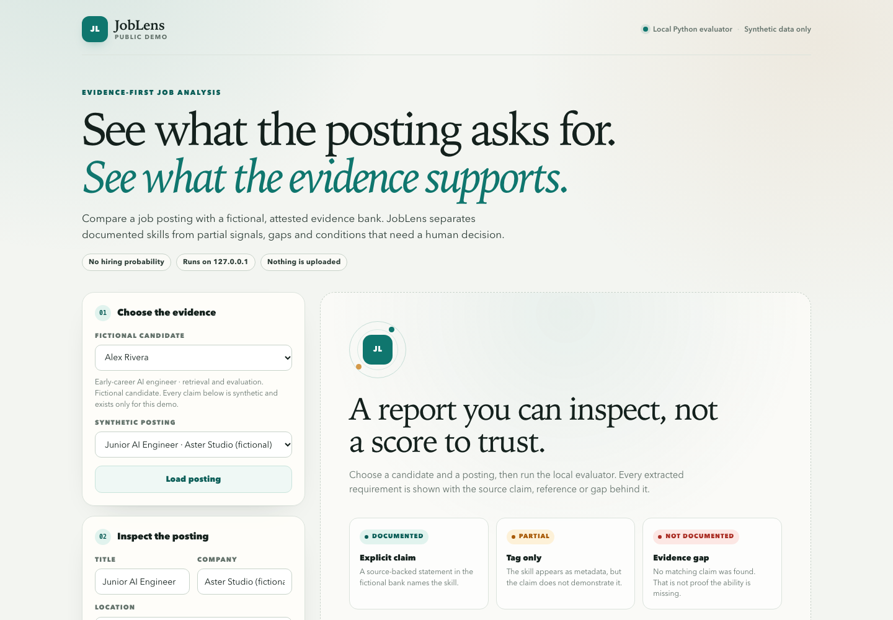
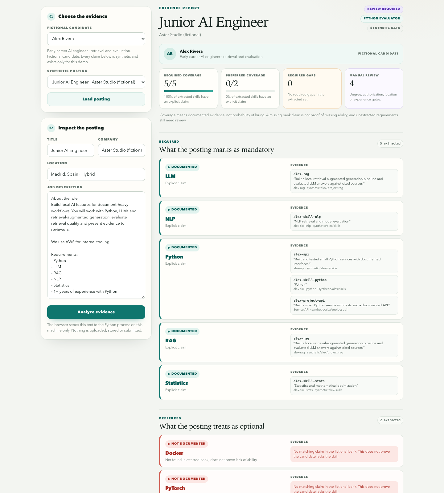
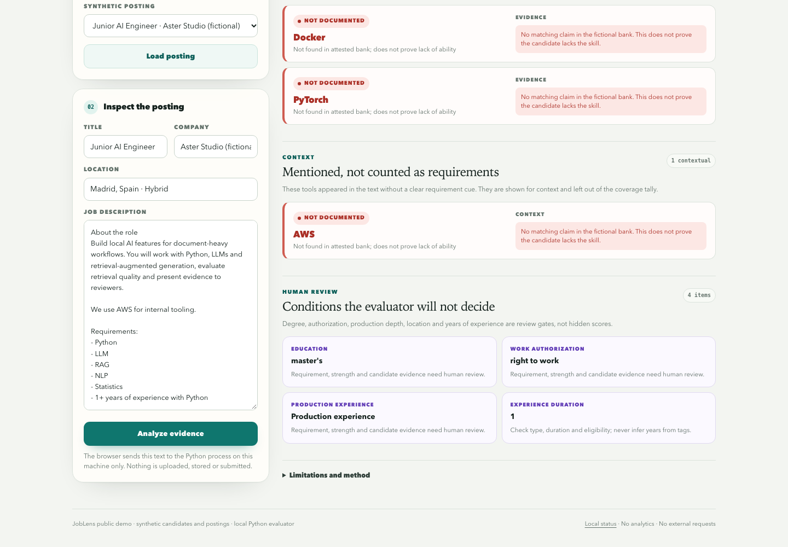
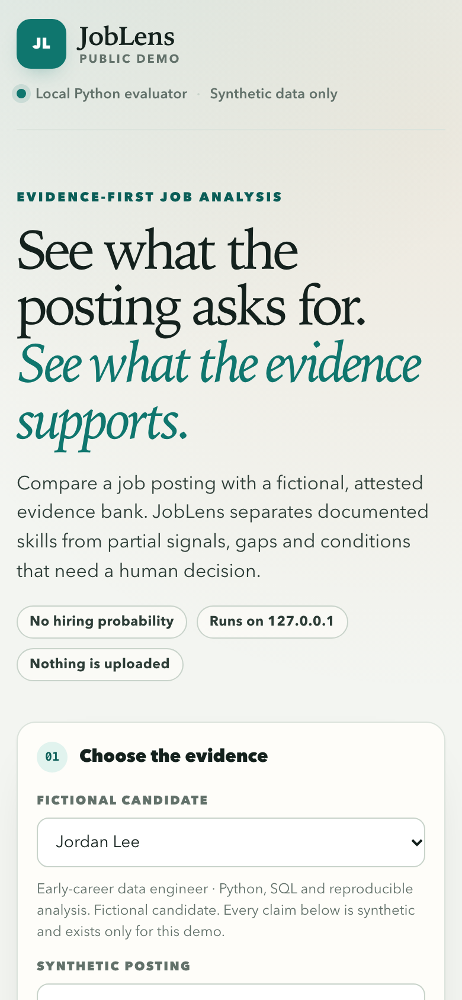

# JobLens Public Demo

**Evidence-first job analysis.** Compare a posting with an attested evidence bank and see
what is documented, what is only a tag, what is missing, and what still needs a human.

This is a small, self-contained public demo. The browser talks to a local Python process;
the report is computed by the real evaluator, not embedded as mock JSON. It does not
produce a hiring score or a probability of getting an interview.

**Python 3.11+ · no runtime dependencies · synthetic data only · loopback only**



## What the demo shows

- **Documented** requirements backed by an exact synthetic claim text, reference id and
  source path shown in the report.
- **Partial** matches where the skill appears only as a tag and needs verification.
- **Evidence gaps** that are shown as gaps, not as proof that a candidate lacks the ability.
- **Manual-review conditions** for degree, work authorization, production depth, location
  and years of experience.
- **Context-only mentions** that are visible but excluded from the coverage tally.
- **Two fictional candidates and three synthetic postings**, switchable from the UI. Changing
  the candidate changes the real Python result.

The interface is responsive, keyboard-friendly and uses no external assets or fonts. The
bank stays server-side; during setup the browser receives candidate metadata and synthetic
postings, and after analysis it receives the selected report, including the exact synthetic
evidence claims and references used in that report.



## Quick start

From the project root:

```bash
python3 run_demo.py
```

That is the whole demo. It starts a loopback server on a free port, opens the browser and
prints the URL. Stop it with `Ctrl+C`.

To use a fixed port:

```bash
python3 run_demo.py --port 8765
```

No `pip install` is required for the demo: `run_demo.py` adds `src/` to the Python path and
the app uses only the standard library.

### Packaging status

Run this release from the source tree with `python3 run_demo.py`. The current wheel is **not a
supported installation method** for this release because it does not include all runtime
resources (the `web/` assets and synthetic `data/` banks). The editable development install
below is only for pytest and Ruff; it does not make an installed wheel self-contained.

## How the live path works

```text
Browser (HTML/CSS/JS)
  |
  |  GET /api/bootstrap
  |    -> fictional candidate metadata + synthetic postings
  |
  |  POST /api/analyze  { candidate_id, job }
  |    -> Python request validation
  |    -> real_fit.evaluate_real_fit(bank, posting)
  |    -> JSON report
  v
127.0.0.1 only
```

The evidence bank is never sent to the browser. The endpoint returns a report produced by
the same evaluator modules vendored in `src/joblens_public/core/` (`models.py`,
`extraction.py`, `real_fit.py`). The public snapshot does not need a private checkout to run.

The server validates the loopback `Host`. Analysis requests must also send an `Origin`
header equal to either `http://127.0.0.1:<port>` or `http://localhost:<port>` for the
server's port, plus a custom request token, the JSON content type and a bounded body size.
It has no persistence, no analytics, no cloud calls and no request logging of pasted text.
Responses carry a restrictive CSP and no-store headers.

## Synthetic data

All names, claims, companies and postings are fictional and exist only to demonstrate the
report. They are not real candidates and not real job openings.

| Candidate | Synthetic focus | File |
| --- | --- | --- |
| Alex Rivera | Retrieval, LLM evaluation, NLP, statistics | `data/candidates/alex-rivera.json` |
| Jordan Lee | Python, SQL, pandas, reproducible analysis, Docker | `data/candidates/jordan-lee.json` |

| Posting | Fictional company | What it exercises |
| --- | --- | --- |
| Junior AI Engineer | Aster Studio | Mostly documented required skills, optional gaps, review gates |
| Data Analyst | Harbor Finance | Strong data fit for one candidate, gaps for the other |
| ML Platform Engineer | Orbit Systems | Infrastructure gaps, optional AI skills, on-site and years gates |

The examples are deterministic with the committed data. For example, Alex + Junior AI Engineer
returns 5/5 documented required skills, 0/2 preferred skills, and `REVIEW_REQUIRED` because the
posting still contains degree, authorization, production and experience gates. The tests lock
these outcomes so the README cannot drift silently.

## Tests and lint

Install the development extras once (or use an existing environment with pytest and Ruff):

```bash
python3 -m pip install -e ".[dev]"
ruff check .
pytest -q
```

The tests cover:

- data validation and the synthetic-data contract;
- evaluator behavior, including candidate switching and "gap is not disqualification";
- the loopback endpoint, real Python results, origin/host/token rejection and CSP headers;
- release-safety checks for private markers, inline scripts/styles and the README contract.

## Screenshots

The committed screenshots are real captures of the running app at exact viewport sizes. The
report screenshots come from `POST /api/analyze`; the query string only opens a deterministic
state, it does not supply a result.

| Image | Viewport | What it shows |
| --- | --- | --- |
| `docs/screenshots/overview-desktop.png` | 1440 × 1000 | Landing page and controls |
| `docs/screenshots/report-desktop.png` | 1440 × 1600 | Report header, summary, required and preferred skills |
| `docs/screenshots/review-desktop.png` | 1440 × 1000 | Gaps, context-only mentions and human-review conditions |
| `docs/screenshots/overview-mobile.png` | 390 × 844 (DPR 2) | Responsive candidate and posting controls |
| `docs/screenshots/report-mobile.png` | 390 × 900 (DPR 2) | Mobile report header and summary |





### Regenerate the screenshots

Start the demo on the default screenshot port, then run the optional Chrome DevTools script:

```bash
PYTHONPATH=src python3 -m joblens_public --port 8765
node scripts/capture_screenshots.mjs
```

The script needs Node 22+ and a local Chrome/Chromium installation. It launches a temporary
headless profile, sets exact device metrics, waits for the Python report and writes the five
PNGs. It does not edit the UI or inject results. See
[`docs/screenshots/README.md`](docs/screenshots/README.md) for manual capture instructions and
the authenticity rules.

## Project layout

```text
JobLens-Public/
├── run_demo.py                 # one-command local demo
├── src/joblens_public/
│   ├── core/                   # vendored evaluator: models, extraction, real_fit
│   ├── data.py                 # validated synthetic data loader
│   ├── webapp.py               # loopback server and /api endpoints
│   └── cli.py                  # python -m joblens_public
├── web/                        # semantic HTML, responsive CSS, vanilla JS
├── data/                       # fictional candidates and synthetic postings
├── tests/                      # focused pytest suite and release-safety checks
├── scripts/capture_screenshots.mjs
└── docs/screenshots/           # authentic screenshots and capture notes
```

## Limitations

JobLens is deliberately narrow. It is an evidence-review aid, not an ATS and not a hiring
predictor.

- The evaluator uses a small, explicit skill vocabulary. A requirement it does not recognise
  is not extracted; it remains for manual review. For example, "agent frameworks" in the
  synthetic AI posting is not counted.
- Coverage means *documented evidence in the fictional bank*, not ability, seniority or
  likelihood of an interview. The report shows the exact synthetic claim text plus its
  reference id and source path where a claim is available.
- The current wheel does not include all runtime resources and is not supported for this
  release. Run from the source tree with `python3 run_demo.py`.
- The bank is attested synthetic data. The demo does not verify claims or read a real CV.
- Degree, authorization, production depth, location and years of experience are reported as
  review gates, never as hidden scores.
- This snapshot has no CV editing, no application submission, no cloud deployment and no
  persistence.
- The larger private project also contains an optional local Ollama tool-calling agent with an
  allowlist, a step limit and human approval. It is **not** part of this snapshot. This demo
  makes no LangGraph or LangChain claim.

## License

MIT. See [LICENSE](LICENSE).

The synthetic candidates, postings and screenshots are included for demonstration only.
